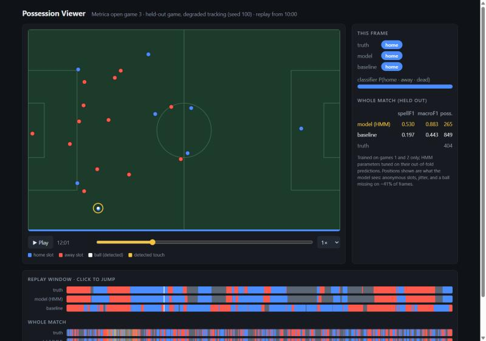

# Ball possession from noisy football tracking

**For every frame of a football match, who has the ball — home, away, or nobody (dead ball)?**

An independent implementation of the task posed by
[More than a Hack 2027](https://github.com/metrica-sports/more-than-a-hack-2027) (Metrica Sports ×
FC Barcelona), built and validated on Metrica's **open** sample games, and scored with the
competition's **own, unmodified metric**.

| held-out game (nested leave-one-game-out) | spellF1 ↑ | macroF1 ↑ | possessions (truth) |
|---|---|---|---|
| official baseline (`baseline_smooth50`) | 0.201 | 0.419 | 772 (373) |
| frame classifier alone | 0.228 | 0.881 | 1251 (373) |
| classifier + HMM, v1 (geometry only) | 0.472 | 0.852 | 258 (373) |
| **classifier + HMM, v2 (+ ball cleaning and touch detection)** | **0.531** | **0.885** | 249 (373) |

*Mean over the three games, each scored after training and tuning on the other two only. Per game,
v2 gains on all three: 0.46 → 0.51, 0.49 → 0.56, 0.47 → 0.53.*

The baseline scores about 0.20 here against 0.24 on the real competition match, a sign that the
simulated noise (below) is about as hard as the real automatic tracking.



---

## The problem in one paragraph

Possession is scored with **spellF1**: each possession (a maximal run of `H` or of `A`) is one
object, matched one-to-one against the truth by temporal IoU and averaged over IoU 0.3–0.7. That
punishes flicker brutally. The frame classifier above gets 84% macro-F1 and is still the *worst*
system on spellF1, because it invents 2,300 possessions in a match that has 373. The whole game is
**segmentation**, not per-frame accuracy. That is why the core of this repo is a Hidden Markov Model.

## Approach

```
open tracking + events
  ├─► ground truth (events → H/A/D per frame)        groundtruth.py
  └─► hackathon-like degradation                     degrade.py
          ball missing on 41% of frames, 46 anonymous track slots,
          20.5 visible players/frame, identity swaps, jitter
        └─► per-frame features (51)                  features.py
              └─► P(H, A, D | frame)  gradient boosting   models/emission.py
                    └─► Viterbi over {H, A, D}     models/hmm.py
                          sticky possession, explicit dead-ball transitions
```

**1. Ground truth from events** (`groundtruth.py`). Possession changes only on events that imply
*control* by the new team: pass, carry, shot, set piece, recovery. Challenges and deflections never
change it, and a loose ball stays with the last team that controlled it, as the challenge's rules
require. The ball is dead from the stoppage (ball out, foul, goal, offside) to the restart. Six
unit tests pin these rules.

**2. Making clean data look like automatic tracking** (`degrade.py`). The open games' ball track is
curated: it disappears almost exactly when the ball is dead (84–99% of dead frames). A model trained
on that learns "no ball = dead ball", which is false on real automatic tracking. So the generator
first *puts a plausible ball back* during stoppages (rolling out, then carried to the restart spot),
then *removes* it with bursty gaps that are likelier in crowds and at high ball speed (balls in the
air), calibrated by bisection to the 41% published for the real data. Player tracks are cut into
tracklets and reassigned to 46 anonymous team slots, so no identity survives. The model only ever
sees this `Observation`, which has the same shape as the competition's ATD.

**3. Features** (`features.py`). Distances from each team's nearest player to the ball, players
within 5 m, ball speed, time since and until the ball is seen, last and next known state, team
centroids and spread in a home-attacking frame, player speeds (stoppages are slow), and rolling
windows of 1, 3 and 8 s.

**3b. Ball cleaning and touch detection** (`features.py`, v2). An error analysis of v1 showed
where it failed: possessions over 16 s were recovered 89% of the time, but those **under 4 s —
46% of all possessions — almost never**. Loosening the HMM did not help (it only invented false
possessions), so the evidence itself was too blurry. The cause: differencing raw ball detections
turns 0.25 m of jitter into ~9 m/s of speed noise and buries every kick. v2 fills short ball gaps,
smooths the track, and detects **touches** as acceleration or turning peaks next to a player. That
gives every frame "who touched last / next", time since and until, and same-team pass-chain
lengths. Against the human event log the detector scores 90% precision and 93% recall on clean
tracking. On degraded tracking its four thresholds were grid-searched on training game 1 only
(touch F1 0.33 → 0.42; recall is capped near 0.6 because the ball is missing 41% of the time).

**4. Classifier + HMM** (`models/`). A gradient-boosted classifier gives P(H, A, D) per frame. It is
trained with every match mirrored (home ↔ away), so it is symmetric by construction. Its posteriors
divided by the class priors become HMM emissions, tempered by `tau` because neighbouring frames are
not independent. Viterbi returns the single most likely segmentation. Four interpretable parameters
(`tau`, switch rate, alive → dead rate, dead → alive rate) are tuned **only on out-of-fold
predictions from the training games**.

## Validation protocol

Nested leave-one-game-out over the three games. Every held-out game is degraded with a noise seed
that no training data used. Nothing is tuned on the data it is scored on, the same principle as the
competition's ban on tuning against its 5 public minutes.

## Reproduce

```bash
pip install -r requirements.txt
python scripts/download_data.py        # ~180 MB of Metrica open data into data/ (git-ignored)
python scripts/evaluate_logo.py        # ~11 min: builds caches, trains, tunes, scores
python scripts/build_viewer.py --game 3 --start-min 10 --minutes 8   # interactive replay
python -m pytest                       # unit tests, no data needed
```

Results land in `outputs/logo_results.csv` and `outputs/logo_params.json`.

**The viewer** (`outputs/viewer_g3.html`, standalone, opens in any browser) replays a held-out game
exactly as the model sees it: anonymous slots, jitter, a ball that comes and goes, and detected
touches. Beside it are the truth, the model and the baseline frame by frame, the classifier's
P(home · away · dead), and possession timelines for the replay window and the whole match. It is
generated locally and git-ignored because it embeds tracking data.

## Repository layout

```
src/possession/
  io_metrica.py     loaders: legacy CSV (games 1-2) and FIFA/EPTS (game 3, and the hackathon ATD)
  groundtruth.py    events -> frame labels
  degrade.py        clean tracking -> hackathon-like noisy tracking
  features.py       per-frame features from an identity-free Observation
  models/           baseline.py (official floor), emission.py (classifier), hmm.py (Viterbi)
  evaluate.py       wrapper around the official metric
  official/         possession_metrics.py, vendored verbatim from the competition (MIT)
  viewer_template.html   standalone replay page, filled in by build_viewer.py
scripts/            download_data.py, evaluate_logo.py, build_viewer.py
tests/              unit tests on synthetic data
```

## Limitations and next steps

- **Short possessions are still the main loss.** The model reports 249 possessions against 373.
  Most misses are spells under 4 s, often a recovery followed by an immediate loss. Note that the
  competition's own ground truth averages 14.2 s per possession against 9.1 s for these
  event-derived labels, so part of that gap may be how strictly "control" is defined, not the model.
- **Not every number is baseline-identical.** In v2 the baseline's distances use the cleaned ball,
  so it scores 0.201 instead of the 0.192 it gets on the raw ball (v1).
- **Three games is a small validation set.** The spellF1 noise band on a full match is about ±0.04.
- **The simulated noise is a model of reality, not reality.** Its parameters come from published
  statistics of the real data, not from that data's actual error patterns.
- **Next:** segment-level re-scoring of HMM candidates, and pass-reception detection (a ball that
  decelerates next to a player) to separate controlled receptions from deflections.

## Data and licence

Code: MIT. The match data is **not** in this repository. It is Metrica Sports' open sample data,
downloaded from [metrica-sports/sample-data](https://github.com/metrica-sports/sample-data).
`src/possession/official/possession_metrics.py` is © Metrica Sports, MIT.
